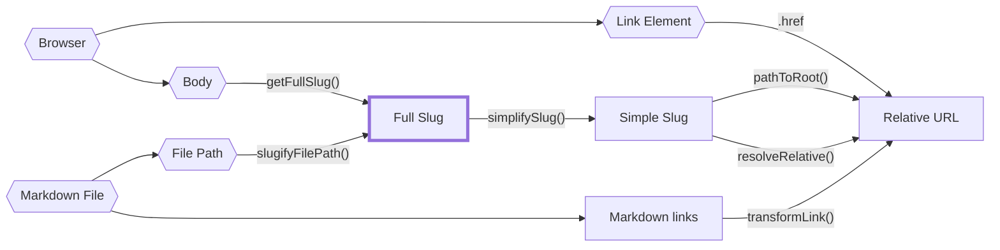

Paths are pretty complex to reason about because, especially for a static site generator, they can come from so many places.

A full file path to a piece of content? Also a path. What about a slug for a piece of content? Yet another path.

It would be silly to type these all as `string` and call it a day as it's pretty common to accidentally mistake one type of path for another. Unfortunately, TypeScript does not have [nominal types](https://en.wikipedia.org/wiki/Nominal_type_system) for type aliases meaning even if you made custom types of a server-side slug or a client-slug slug, you can still accidentally assign one to another and TypeScript wouldn't catch it.

Luckily, we can mimic nominal typing using [brands](https://www.typescriptlang.org/play#example/nominal-typing).

```typescript
// instead of
type FullSlug = string

// we do
type FullSlug = string & { _brand: "FullSlug" }

// that way, the following will fail typechecking
const slug: FullSlug = "some random string"
```

While this prevents most typing mistakes _within_ our nominal typing system (e.g. mistaking a server slug for a client slug), it doesn't prevent us from _accidentally_ mistaking a string for a client slug when we forcibly cast it.

Thus, we still need to be careful when casting from a string to one of these nominal types in the 'entrypoints', illustrated with hexagon shapes in the diagram below.

The following diagram draws the relationships between all the path sources, nominal path types, and what functions convert between them. In Quartz core they live in `quartz/util/path.ts`; plugins import the same functions from `@quartz-community/utils` (the types `FilePath`, `FullSlug` and `SimpleSlug` from `@quartz-community/types`).



Here are the main types of slugs with a rough description of each type of path:

- `FilePath`: a real file path to a file on disk. Cannot be relative and must have a file extension.
- `FullSlug`: cannot be relative and may not have leading or trailing slashes. It can have `index` as it's last segment. Use this wherever possible is it's the most 'general' interpretation of a slug.
- `SimpleSlug`: cannot be relative and shouldn't have `/index` as an ending or a file extension. It _can_ however have a trailing slash to indicate a folder path.
- `RelativeURL`: must start with `.` or `..` to indicate it's a relative URL. Shouldn't have `/index` as an ending or a file extension but can contain a trailing slash.

To get a clearer picture of how these relate to each other, take a look at the path tests in `quartz/util/path.test.ts`.

## A page's slug

`slugifyFilePath()` lowercases, replaces spaces with `-` and normalizes Unicode to NFC (so `café.md` written in NFD, as macOS does, gets the same slug). But a page isn't always published at the slug of its file path: a note with a `permalink` in its frontmatter is published at that address instead (see [[built-in processing]]). Always use `file.data.slug` (or `fileData.slug` in components) for a page's address, and `file.data.relativePath` / `filePath` for its file; don't recompute the slug from the path.

## Links

To resolve a link the way Quartz does, use `transformLink(src, target, { strategy, allSlugs })`: `src` is the current page's slug, `strategy` is the site's `configuration.links.markdownLinkResolution` (`absolute`, `relative` or `shortest`) and `allSlugs` is `ctx.allSlugs`. It decodes percent-encoding, applies the same slug rules as `slugifyFilePath()` and resolves folder notes. A Markdown link whose path doesn't percent-decode (`[x](%zz)`) is external in Obsidian and in Quartz; check with `linkPathDecodes(link)` before treating a link as internal. `splitAnchor(link)` splits off the `#anchor` and slugs it as a heading anchor.

## Headings and anchors

Heading ids follow the GitHub rule (`github-slugger`, as `rehype-slug` and the table of contents use): lowercase, punctuation removed, spaces replaced by `-`, other letters and digits kept. Plugins that give headings ids or link to headings must use the helpers from `@quartz-community/utils`, so ids and anchors match:

- `slugHeading(text)`: the id of a heading with this text;
- `HeadingSlugger`: slugs all headings of one page in order and numbers repeats (`foo`, `foo-1`, …) — create one per page;
- `obsidianHeadingAnchor(text)`: the anchor Obsidian writes for a heading (it replaces `:`, `|`, `^`, `#` and `\` with spaces); slug it with `slugHeading` and add it as an extra id when it differs;
- `resolveAnchorHref(href, ids)`: points a same-page `#anchor` at an id that exists on the page (an id as written, a block reference `#^name`, or a heading's text);
- `slugTag(tag)`: the slug of a tag, as used for tag pages.
