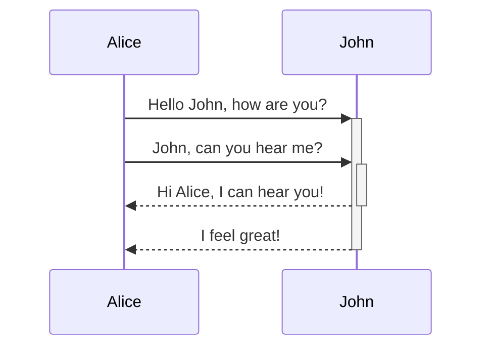

Quartz supports [Mermaid](https://mermaid.js.org) for diagrams and charts in your notes (flow charts, sequence diagrams, timelines, and so on). This is part of [[Obsidian compatibility]] and can be turned on or off on that plugin.

Default renderer is Mermaid.js. Set `diagramRenderer: pele` on [[ObsidianFlavoredMarkdown]] to use [Pele](https://pele.run) instead. Mermaid.js is deprecated; Pele will become the default later.

> [!warning]
> Wondering why Mermaid diagrams may not be showing up even if you have them enabled? You may need to reorder your plugins so that [[ObsidianFlavoredMarkdown]] is _after_ [[SyntaxHighlighting]].

```yaml title="quartz.config.yaml"
plugins:
  - source: github:quartz-community/obsidian-flavored-markdown
    options:
      mermaid: true
      diagramRenderer: pele # default: mermaid
```

## Syntax

To add a Mermaid diagram, create a mermaid code block.

````

````


