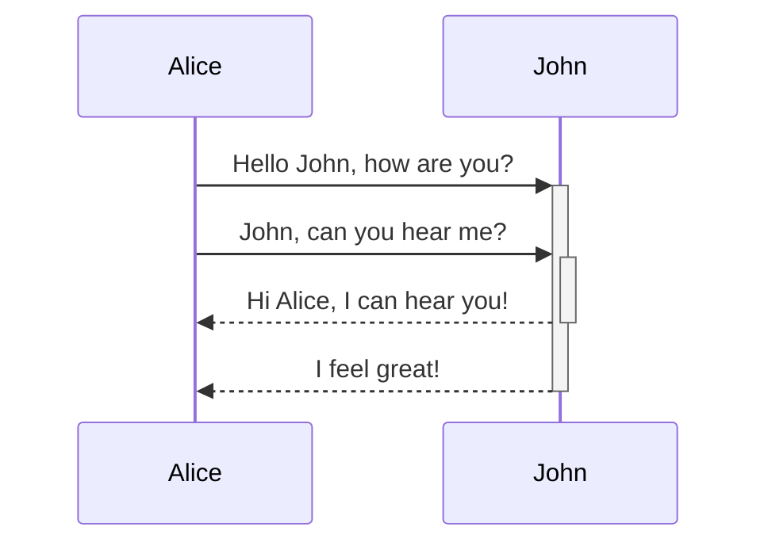

Quartz supports [Mermaid](https://mermaid.js.org) syntax for diagrams and charts in your notes (flow charts, sequence diagrams, timelines, and more). This is enabled as a part of [[Obsidian compatibility]] and can be configured and enabled/disabled from that plugin.

By default, Quartz renders Mermaid fences with Mermaid.js so existing sites keep working. You can opt into [Pele](https://pele.run) (Obsidian's Mermaid-compatible SVG renderer) with `diagramRenderer: pele` on [[ObsidianFlavoredMarkdown]]. Mermaid.js is on a deprecation path toward Pele as the long-term default; Pele stays opt-in for now.

> [!warning]
> Wondering why Mermaid diagrams may not be showing up even if you have them enabled? You may need to reorder your plugins so that [[ObsidianFlavoredMarkdown]] is _after_ [[SyntaxHighlighting]].

## Choosing a renderer

```yaml title="quartz.config.yaml"
plugins:
  - source: github:quartz-community/obsidian-flavored-markdown
    options:
      mermaid: true
      diagramRenderer: pele # default is mermaid
```

## Syntax

To add a Mermaid diagram, create a mermaid code block.

````

````


