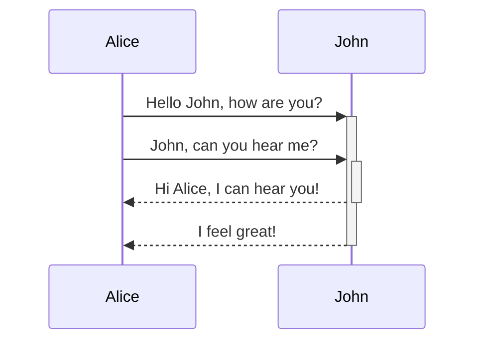

Quartz supports [Mermaid](https://mermaid.js.org) syntax for diagrams and charts in your notes (flow charts, sequence diagrams, timelines, and the rest of Mermaid 12.1's built-in types). This is enabled as a part of [[Obsidian compatibility]] and can be configured and enabled/disabled from that plugin.

Diagrams are rendered with [Pele](https://pele.run), Obsidian's Mermaid-compatible SVG renderer. Pele keeps the same fence language (`mermaid`) and themes from Quartz CSS variables, so light and dark mode match the site without a Mermaid.js dependency.

> [!warning]
> Wondering why Mermaid diagrams may not be showing up even if you have them enabled? You may need to reorder your plugins so that [[ObsidianFlavoredMarkdown]] is _after_ [[SyntaxHighlighting]].

## Syntax

To add a Mermaid diagram, create a mermaid code block.

````

````


